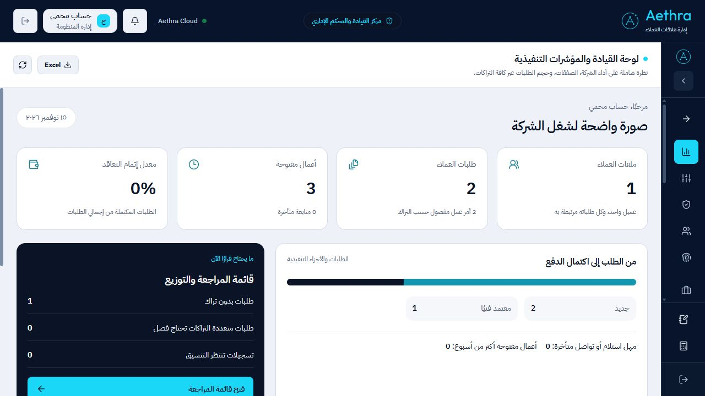
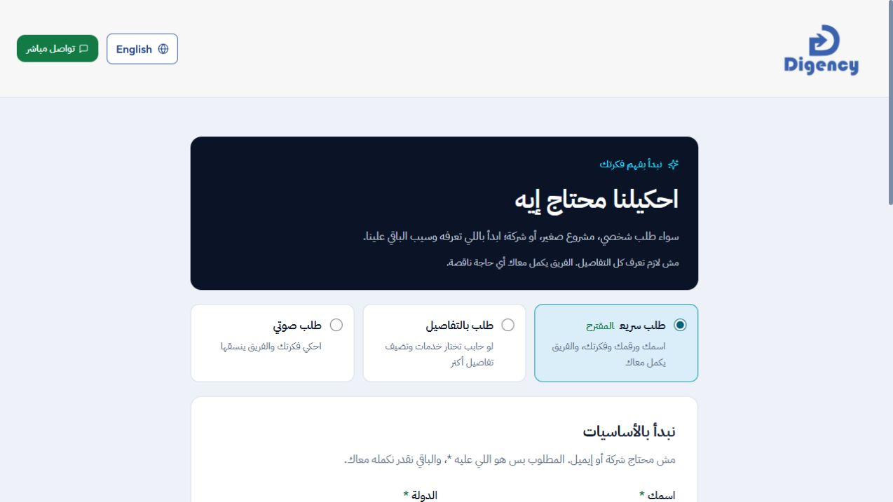
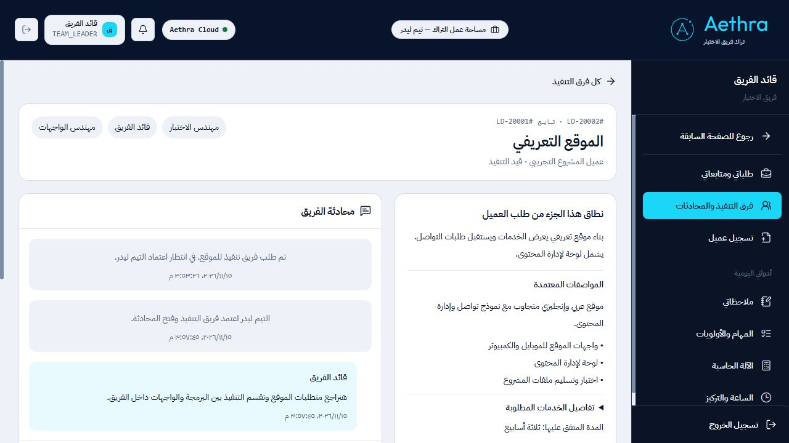
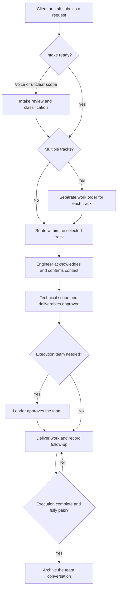

<div align="center">
  <picture>
    <source media="(prefers-color-scheme: dark)" srcset="client/public/brand/aethra-logo-light.svg">
    
  </picture>
  <h1>Aethra CRM</h1>
  <p><strong>Client intake, intelligent routing, and project delivery in one workspace.</strong></p>
  <p>
    
    
    
    
    
  </p>
  <p><a href="#quick-start">Quick start</a> · <a href="#workflow">Workflow</a> · <a href="#access-and-ownership">Permissions</a> · <a href="#documentation">Documentation</a></p>
</div>

## Overview

Aethra is a CRM for service teams that turn incoming requests into assigned work. It connects customer intake, track-specific routing, technical discovery, execution teams, and payment records while keeping access tied to each person's responsibilities.

The internal workspace uses the **Aethra** identity. The customer-facing intake page has a configurable company name and logo, with **Digency** as the initial brand. Company branding stays separate from the internal product identity.

**بالعربي:** نظام لاستقبال طلبات العملاء وتوزيعها على التراكات ومتابعة التنفيذ والمستحقات. يدعم تسجيل العميل بنفسه أو بواسطة موظف، وفصل الطلب متعدد التراكات إلى أجزاء مستقلة، وفرق تنفيذ ومحادثات بصلاحيات محددة. [دليل التشغيل العربي](SETUP_GUIDE.md).

## Capabilities

| Area | What it supports |
| --- | --- |
| Client intake | Arabic/English portal, quick or detailed requests, optional company/email fields, country calling codes, referral sources, attachments, and voice requests. |
| Customer records | One profile per normalized phone number, with independent request codes and histories for repeat inquiries. |
| Intake coordination | Staff-assisted registration with authenticated referral attribution; voice requests wait for review before routing. |
| Work orders | Separate scope, services, selected attachments, assignee, currency, and payment records for each track under one parent request. |
| Routing | Manual assignment, round robin, least-busy and skill-based routing, receiver capacity, acknowledgment/contact deadlines, and SLA escalation. |
| Technical discovery | Contact confirmation, requirements, discussion notes, deliverables, budgets, and protected attachments. |
| Execution teams | Engineer requests, leader approval, same-track participant selection, team messaging, membership revocation, and read-only archives. |
| Payments | Deposits and final settlement, retained receipts, independent payments per work order, and revenue by currency. |
| Administration | Operational dashboard, customer directory, track management, role editor, password-reset requests, and access-controlled audit records. |
| Personal workspace | Private notes and tasks, calculator, Cairo clock, and focus timer. |

## Interface preview

These captures use an isolated preview database and demonstration accounts.



<details>
<summary>Client portal and execution workspace</summary>





</details>

## Workflow



- Unclassified requests wait for an authorized intake decision; routing does not guess a track.
- Services in one track can share a work order. Different tracks receive separate scopes and financial records.
- A deposit keeps the work order open. The conversation is archived when execution is complete and payment is settled, whichever happens last.
- The parent request groups its work orders and does not duplicate their payment totals.

## Technology and structure

| Layer | Implementation |
| --- | --- |
| Client | React 18, TypeScript, Vite, Tailwind CSS, Axios, Lucide, Sonner |
| API | Express 4, TypeScript, Zod validation, JWT authentication, bcrypt |
| Persistence | MongoDB with Mongoose |
| Updates | Server-Sent Events, with scoped API reads for current state and messages |
| Files and exports | Validated local uploads, authorized downloads, ExcelJS reports |
| Verification | Node test runner, temporary MongoDB instances, browser checks |

```text
Aethra-CRM/
├── client/
│   ├── public/brand/       # Product assets, client logo, and local fonts
│   └── src/
│       ├── branding/      # Customer portal branding
│       ├── components/    # Navigation, forms, request coordination
│       ├── i18n/          # Arabic/English portal messages
│       └── pages/         # Intake, administration, teams, personal desk
├── server/
│   ├── src/
│   │   ├── controllers/   # Application actions
│   │   ├── middlewares/   # Authentication, validation, uploads
│   │   ├── models/        # MongoDB documents
│   │   ├── routes/        # Public and authenticated endpoints
│   │   ├── services/      # Routing, execution, permissions, lifecycle
│   │   └── sse/           # Live notification connections
│   ├── test/              # Integration tests and isolated UI preview
│   └── .env.example       # Configuration template, without credentials
├── docs/                  # Workflow, permissions, branding guides
└── scripts/               # Brand asset generation utilities
```

## Quick start

### 1. Prerequisites

- Node.js **22 or newer** and npm. Local verification used Node.js 25.
- A running MongoDB instance for application data.
- The `mongod` executable for integration tests, which create a separate temporary database.

### 2. Clone and install

```sh
git clone https://github.com/Tarekattallah/Aethra-CRM.git
cd Aethra-CRM
npm --prefix server ci
npm --prefix client ci
```

Client and server are separate packages; the commands use `--prefix` from the repository root.

### 3. Configure the API

For a fresh checkout, copy the configuration template:

```powershell
Copy-Item server/.env.example server/.env
```

On macOS/Linux, use `cp server/.env.example server/.env`. Keep an existing installation's environment and database settings when updating its code.

| Variable | Purpose |
| --- | --- |
| `PORT` | API port; the development setup uses `5000`. |
| `CLIENT_URL` | Allowed client origin, initially `http://localhost:5173`. |
| `MONGODB_URI` | Application database connection string. |
| `JWT_SECRET` | Required signing secret, at least 32 characters. |
| `JWT_EXPIRES_IN` | Token lifetime, initially `1d`. |
| `BUSINESS_TIMEZONE` | Business-day timezone, initially `Africa/Cairo`. |
| `UPLOAD_DIR` | Optional persistent upload directory; defaults to `server/uploads`. |

Generate a signing secret locally and place it in `server/.env`:

```sh
node -e "console.log(require('node:crypto').randomBytes(48).toString('hex'))"
```

### 4. Start development

Run each command in its own terminal:

```sh
npm --prefix server run dev
```

```sh
npm --prefix client run dev
```

| Service | Address |
| --- | --- |
| Client | `http://localhost:5173` |
| API | `http://localhost:5000/api` |
| Database-aware health check | `http://localhost:5000/api/health` |

Vite forwards `/api` to Express during development. Set `API_PROXY_TARGET` to use a different development backend.

### 5. Initialize the system owner

Create the first protected owner locally for a new database:

```sh
npm --prefix server run bootstrap:superadmin -- --email owner@example.com --confirm --create
```

The command generates a random password in **`server/.env.superadmin.local`**, which is ignored by Git. It refuses to create a second protected owner. Omitting `--create` can promote an existing eligible Admin while retaining its password.

Open employee sign-in by clicking the client portal logo **six times**. After signing in as the owner, configure operational accounts, roles, tracks, services, and the client portal identity from administration.

For an **empty, disposable demonstration database** only:

```sh
npm --prefix server run seed
```

The seed command refuses non-empty databases and production mode. Application startup does not seed or replace existing accounts.

## Access and ownership

| Responsibility | Access model |
| --- | --- |
| System owner | Full access, editing existing system roles, protected account management, and exclusive client-brand configuration. |
| Operational Admin | Clients, requests, assignment, tracks, execution, payments, reports, routing policy, and eligible employee password resets. Account/role governance, service-form administration, and security audit access are excluded by default. |
| Team leader | Engineer duties plus permissions for the assigned track and its execution teams. |
| Engineer | Assigned work and execution spaces the engineer is authorized to join. |
| Intake / marketing | Delegated registration, attribution, voice coordination, and permitted request history. |
| Custom role | Explicit permissions selected in the role editor, subject to data and ownership boundaries. |

The catalog contains **28 delegable permissions** and one owner-only branding capability. Track boundaries still apply to referral owners and broad grants. Team membership does not expose other tracks or financial receipts. Permission changes revoke inherited sessions; custom per-account grants remain separate from role inheritance.

See the [complete permission matrix](docs/PERMISSIONS_AND_BRANDING_AR.md).

## Verification

```sh
npm --prefix server run build
npm --prefix client run build
npm --prefix server test
```

The integration suite currently contains **76 tests** covering intake, routing, account boundaries, role changes, protected accounts, files, work-order separation, payments, execution teams, and branding. Tests start an isolated MongoDB process and remove only their temporary data.

If `mongod` is not available at the default location, set `MONGOD_BINARY`. For example, in PowerShell:

```powershell
$env:MONGOD_BINARY = (Get-Command mongod).Source
npm --prefix server test
```

The optional `server/test/preview.ts` runner creates a disposable UI preview. It is not the production startup entry point.

## Deployment notes

- Build the client and API, then run Express with `npm --prefix server start`.
- Serve `client/dist` with SPA fallback and forward `/api` to Express on the same public origin. Vite's proxy is a development feature.
- Configure HTTPS, `NODE_ENV=production`, database access, the signing secret, and `CLIENT_URL` for the deployed environment.
- Persist and back up MongoDB data and uploads independently of application builds.
- Voice requests require staff coordination; this repository does not call an external speech-to-text service.
- Receipts record confirmed payment activity. The application does not process payments through a payment gateway.

## Documentation

| Guide | Contents |
| --- | --- |
| [Arabic setup guide](SETUP_GUIDE.md) | Installation, owner initialization, development commands |
| [Company workflows](docs/COMPANY_WORKFLOWS_AR.md) | Intake, voice coordination, accounts, routing, daily work |
| [Execution teams](docs/EXECUTION_TEAMS_AR.md) | Work orders, team membership, separate payments, archives |
| [Permissions and portal branding](docs/PERMISSIONS_AND_BRANDING_AR.md) | Full permission catalog and owner-only company identity |
| [Language and typography](docs/CLIENT_INTAKE_LANGUAGE_AND_TYPE_AR.md) | Arabic/English behavior, local fonts, readability |
| [Product brand](docs/BRAND.md) | Aethra identity and visual assets |

## Repository contents

Application source, lockfiles, assets, and documentation are included. Runtime credentials, environment files, uploaded customer files, local database files, installed dependencies, and generated builds are excluded. Font license notices are distributed alongside the bundled fonts.
